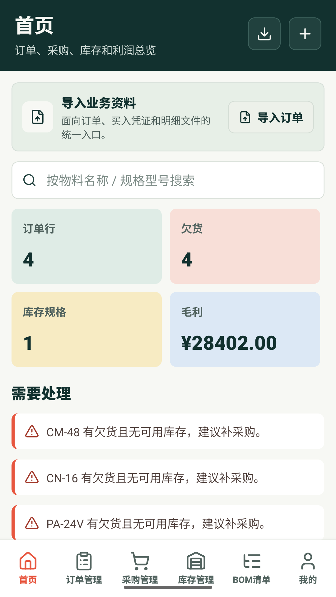
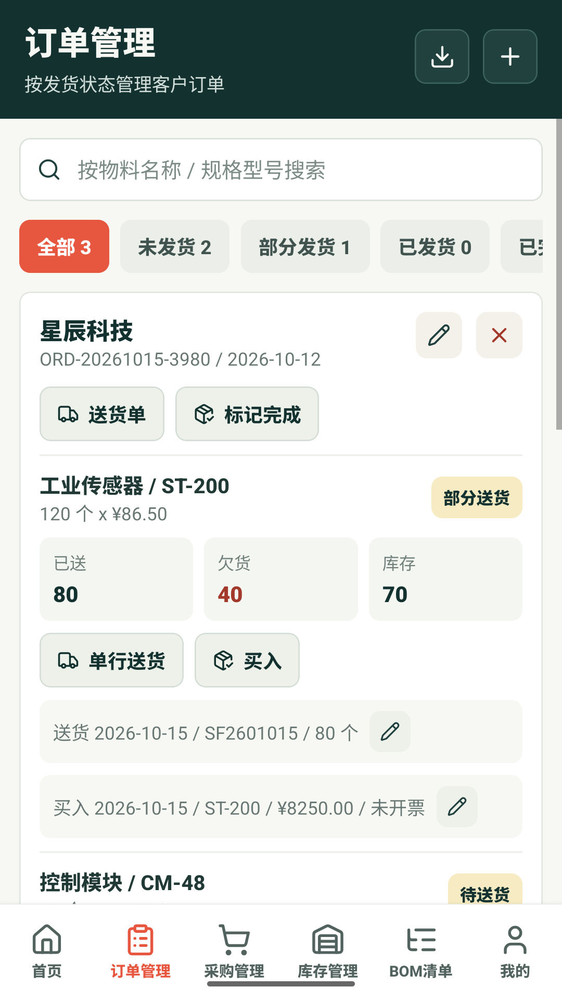
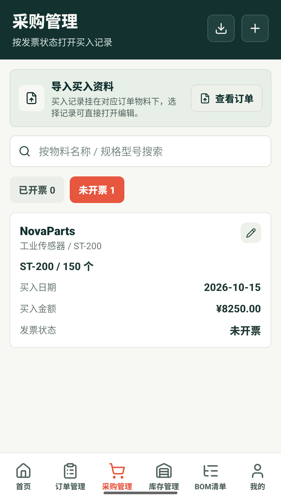
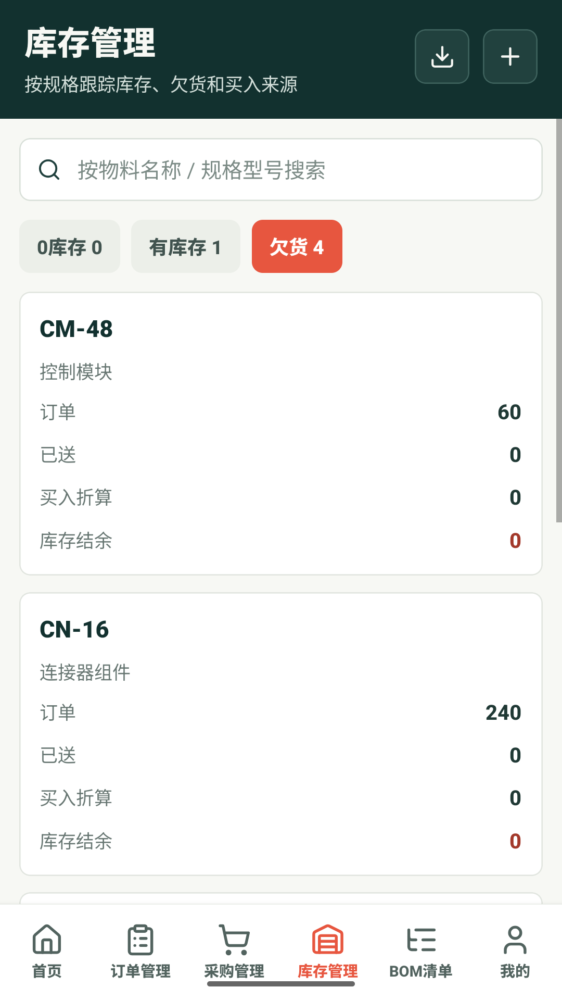
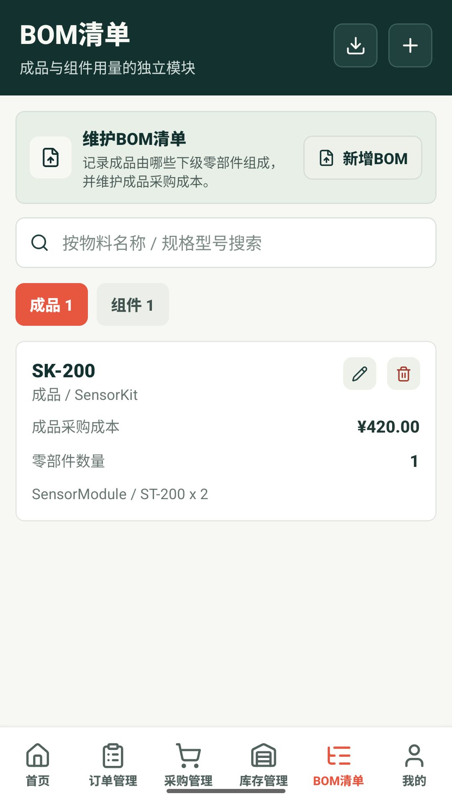
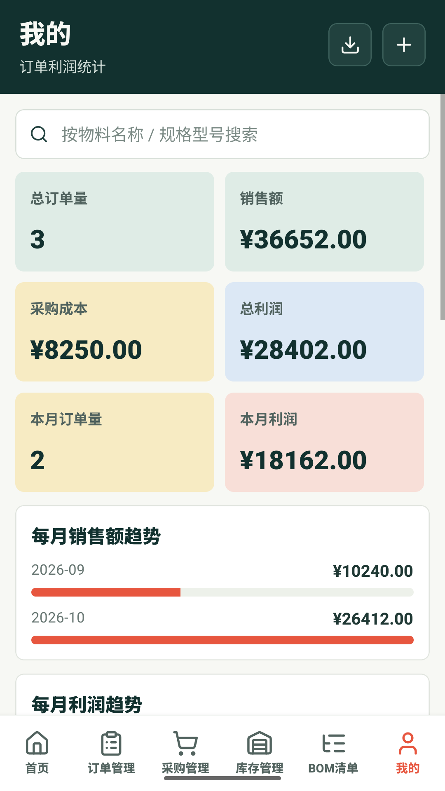

# 订单台账

用于管理客户订单、采购、送货、库存、BOM 和利润的移动应用。

## 截图

| 首页 | 订单管理 | 采购管理 |
| :---: | :---: | :---: |
|  |  |  |

| 库存管理 | BOM 清单 | 利润统计 |
| :---: | :---: | :---: |
|  |  |  |

截图来自 Android 模拟器中的应用，使用虚构的演示数据。`assets/play-screenshots/` 同时存放 Google Play 手机截图，按文件名前缀顺序上传。
