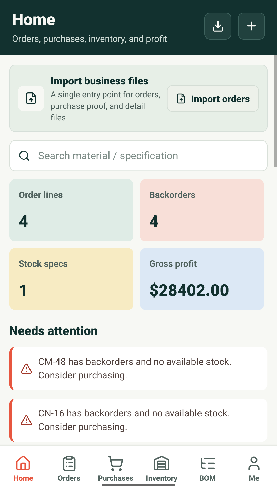
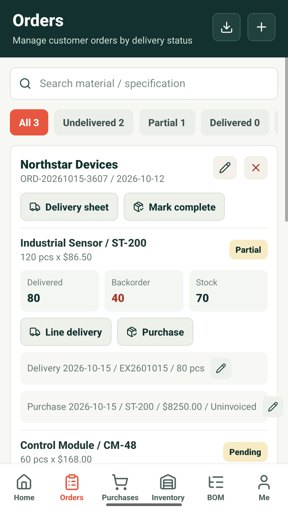
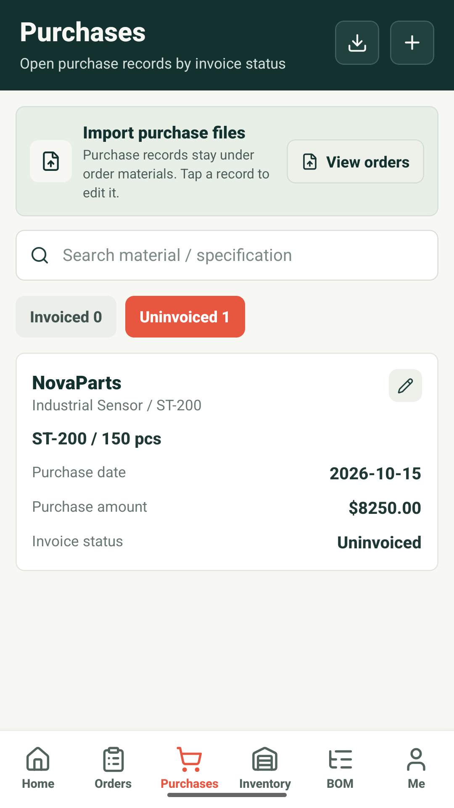
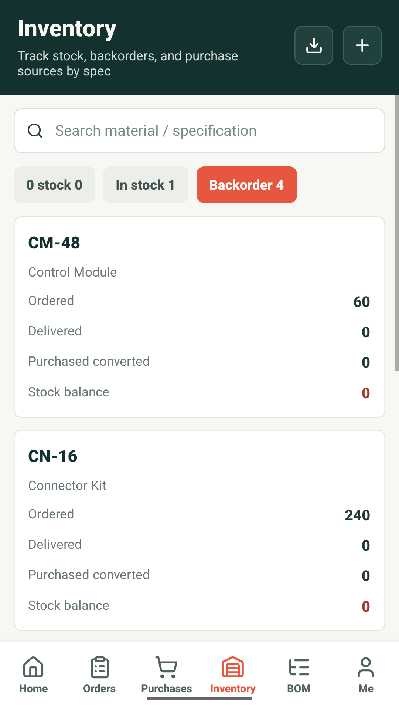
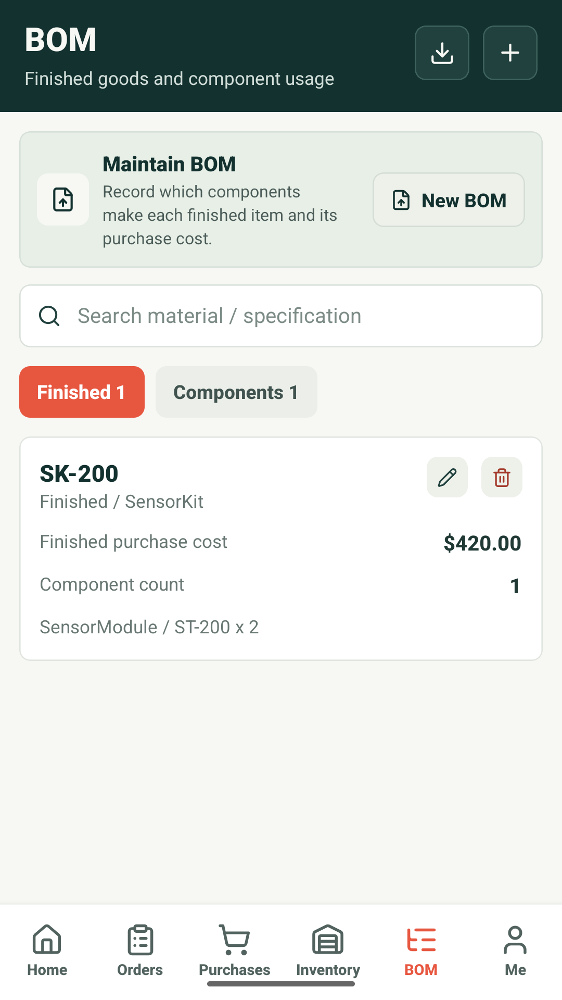
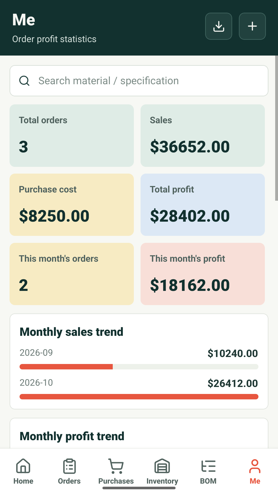

# Order Ledger

A mobile app for managing customer orders, purchases, deliveries, inventory, bills of materials, and profit.

## Screenshots

| Home | Orders | Purchases |
| :---: | :---: | :---: |
|  |  |  |

| Inventory | BOM | Profit statistics |
| :---: | :---: | :---: |
|  |  |  |

These screenshots come from the Android emulator with fictional English demo data. Upload the phone screenshots in `assets/play-screenshots/` to Google Play in filename order.
